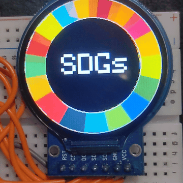

# sdgs



A tiny display toy: an **ESP32-C3** drives a **1.28" round LCD (GC9A01A)** that renders the
17-colour SDGs wheel, spinning, with `SDGs` in the centre.

Everything is drawn by hand in ~90 lines — no image assets:

- each colour wedge is two filled triangles (`drawSDGsArc`),
- the ring is repainted **in place** every frame (the screen is never cleared) so it doesn't flicker,
- the centre label is drawn **last** so the wheel can't overwrite it.

## Hardware
- **ESP32-C3** board (e.g. ESP32-C3 SuperMini)
- **GC9A01A** 1.28" 240×240 round SPI LCD

### Wiring (SPI)
| ESP32-C3 | LCD  |
|----------|------|
| GPIO1    | RES  |
| GPIO2    | DC   |
| GPIO4    | SCLK |
| GPIO6    | MOSI |
| GPIO7    | CS   |
| 3V3      | VCC  |
| GND      | GND  |

## Build
Uses [PlatformIO](https://platformio.org/):

```
pio run -t upload
```

## License
MIT
